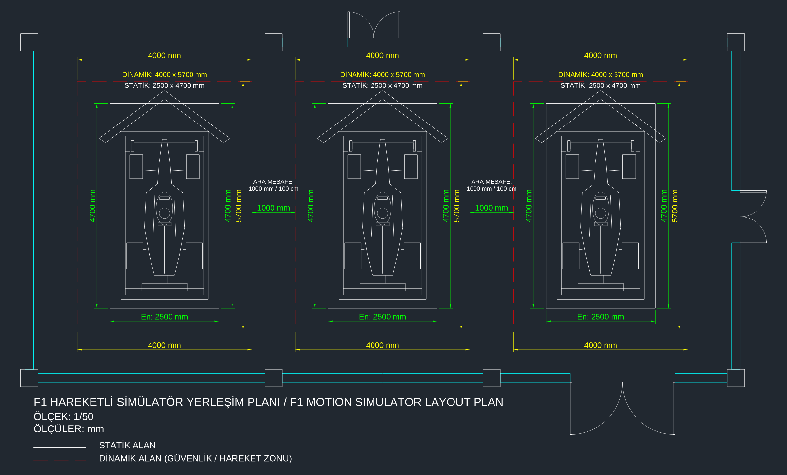

# F1 Hareketli Simülatör Yerleşim Planı / F1 Motion Simulator Layout Plan

Ölçek 1/50 · Ölçüler mm · 3 simülatör bölmesi (dinamik alan 4000 x 5700, statik alan 2500 x 4700, ara mesafe 1000 mm).

## İndir
- [DWG (AutoCAD 2018)](https://github.com/Yalvero/f1-simulator-yerlesim-plani/releases/latest/download/f1-simulator-yerlesim-plani.dwg)
- [DXF](https://github.com/Yalvero/f1-simulator-yerlesim-plani/releases/latest/download/f1-simulator-yerlesim-plani.dxf)
- [PNG önizleme](https://github.com/Yalvero/f1-simulator-yerlesim-plani/releases/latest/download/f1-simulator-yerlesim-plani.png)
